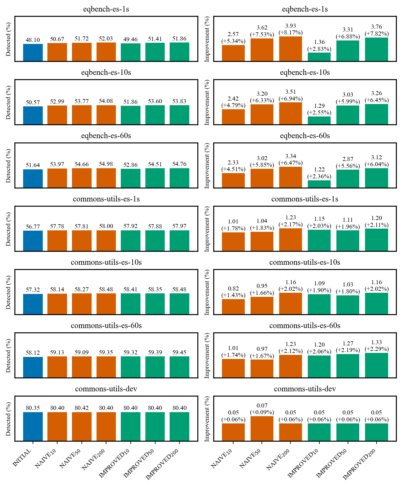

# RQ1 - Mutation-score improvement

_Source database: `postgres_dev`._

## Mutation score

**Number of total, covered, and uncovered mutants in included classes per project.**

| Project | Test Methods | Impl. Classes | Total | Covered | Uncovered |
| --- | --- | --- | --- | --- | --- |
| EqBench-ES (1 s) | 3,937 (83.4%) | 607 (93.1%) | 23,905 | 21,492 (89.9%) | 2,413 (10.1%) |
| EqBench-ES (10 s) | 4,049 (83.1%) | 600 (92.0%) | 23,654 | 21,657 (91.6%) | 1,997 (8.4%) |
| EqBench-ES (60 s) | 4,124 (82.9%) | 603 (92.5%) | 23,663 | 22,010 (93.0%) | 1,653 (7.0%) |
| Commons-ES (1 s) | 2,079 (83.8%) | 111 (44.9%) | 8,581 | 7,536 (87.8%) | 1,045 (12.2%) |
| Commons-ES (10 s) | 2,330 (85.1%) | 112 (45.3%) | 8,391 | 7,939 (94.6%) | 452 (5.4%) |
| Commons-ES (60 s) | 2,326 (85.0%) | 112 (45.3%) | 8,354 | 8,109 (97.1%) | 245 (2.9%) |
| Commons Utils | 461 (63.6%) | 90 (36.4%) | 8,096 | 5,215 (64.4%) | 2,881 (35.6%) |

source: [`compute_project_mutation_coverage`](https://github.com/glockyco/Teralizer/blob/54d4a4e231f92dc5e8bc3238623cc75b7415e8ad/analysis/src/teralizer/rq1_mutation_detection.py#L253)

**Mutation detection rates and improvements across projects and variants.**

source: [`compute_detection_improvements`](https://github.com/glockyco/Teralizer/blob/54d4a4e231f92dc5e8bc3238623cc75b7415e8ad/analysis/src/teralizer/rq1_mutation_detection.py#L275)

**Detected share of covered mutants per project and strategy, with the gain over the initial test suite.**

| Project | Strategy | Detected of covered | Gain (pp) | Relative gain |
| --- | --- | --- | --- | --- |
| EqBench-ES (1 s) | Initial | 48.10% | 0.00 | +0.00% |
| EqBench-ES (1 s) | Naive (10 tries) | 50.67% | 2.57 | +5.34% |
| EqBench-ES (1 s) | Naive (50 tries) | 51.72% | 3.62 | +7.53% |
| EqBench-ES (1 s) | Naive (200 tries) | 52.03% | 3.93 | +8.17% |
| EqBench-ES (1 s) | Improved (10 tries) | 49.46% | 1.36 | +2.83% |
| EqBench-ES (1 s) | Improved (50 tries) | 51.41% | 3.31 | +6.88% |
| EqBench-ES (1 s) | Improved (200 tries) | 51.86% | 3.76 | +7.82% |
| EqBench-ES (10 s) | Initial | 50.57% | 0.00 | +0.00% |
| EqBench-ES (10 s) | Naive (10 tries) | 52.99% | 2.42 | +4.79% |
| EqBench-ES (10 s) | Naive (50 tries) | 53.77% | 3.20 | +6.33% |
| EqBench-ES (10 s) | Naive (200 tries) | 54.08% | 3.51 | +6.94% |
| EqBench-ES (10 s) | Improved (10 tries) | 51.86% | 1.29 | +2.55% |
| EqBench-ES (10 s) | Improved (50 tries) | 53.60% | 3.03 | +5.99% |
| EqBench-ES (10 s) | Improved (200 tries) | 53.83% | 3.26 | +6.45% |
| EqBench-ES (60 s) | Initial | 51.64% | 0.00 | +0.00% |
| EqBench-ES (60 s) | Naive (10 tries) | 53.97% | 2.33 | +4.51% |
| EqBench-ES (60 s) | Naive (50 tries) | 54.66% | 3.02 | +5.85% |
| EqBench-ES (60 s) | Naive (200 tries) | 54.98% | 3.34 | +6.47% |
| EqBench-ES (60 s) | Improved (10 tries) | 52.86% | 1.22 | +2.36% |
| EqBench-ES (60 s) | Improved (50 tries) | 54.51% | 2.87 | +5.56% |
| EqBench-ES (60 s) | Improved (200 tries) | 54.76% | 3.12 | +6.04% |
| Commons-ES (1 s) | Initial | 56.77% | 0.00 | +0.00% |
| Commons-ES (1 s) | Naive (10 tries) | 57.78% | 1.01 | +1.78% |
| Commons-ES (1 s) | Naive (50 tries) | 57.81% | 1.04 | +1.83% |
| Commons-ES (1 s) | Naive (200 tries) | 58.00% | 1.23 | +2.17% |
| Commons-ES (1 s) | Improved (10 tries) | 57.92% | 1.15 | +2.03% |
| Commons-ES (1 s) | Improved (50 tries) | 57.88% | 1.11 | +1.96% |
| Commons-ES (1 s) | Improved (200 tries) | 57.97% | 1.20 | +2.11% |
| Commons-ES (10 s) | Initial | 57.32% | 0.00 | +0.00% |
| Commons-ES (10 s) | Naive (10 tries) | 58.14% | 0.82 | +1.43% |
| Commons-ES (10 s) | Naive (50 tries) | 58.27% | 0.95 | +1.66% |
| Commons-ES (10 s) | Naive (200 tries) | 58.48% | 1.16 | +2.02% |
| Commons-ES (10 s) | Improved (10 tries) | 58.41% | 1.09 | +1.90% |
| Commons-ES (10 s) | Improved (50 tries) | 58.35% | 1.03 | +1.80% |
| Commons-ES (10 s) | Improved (200 tries) | 58.48% | 1.16 | +2.02% |
| Commons-ES (60 s) | Initial | 58.12% | 0.00 | +0.00% |
| Commons-ES (60 s) | Naive (10 tries) | 59.13% | 1.01 | +1.74% |
| Commons-ES (60 s) | Naive (50 tries) | 59.09% | 0.97 | +1.67% |
| Commons-ES (60 s) | Naive (200 tries) | 59.35% | 1.23 | +2.12% |
| Commons-ES (60 s) | Improved (10 tries) | 59.32% | 1.20 | +2.06% |
| Commons-ES (60 s) | Improved (50 tries) | 59.39% | 1.27 | +2.19% |
| Commons-ES (60 s) | Improved (200 tries) | 59.45% | 1.33 | +2.29% |
| Commons Utils | Initial | 80.35% | 0.00 | +0.00% |
| Commons Utils | Naive (10 tries) | 80.40% | 0.05 | +0.06% |
| Commons Utils | Naive (50 tries) | 80.42% | 0.07 | +0.09% |
| Commons Utils | Naive (200 tries) | 80.40% | 0.05 | +0.06% |
| Commons Utils | Improved (10 tries) | 80.40% | 0.05 | +0.06% |
| Commons Utils | Improved (50 tries) | 80.40% | 0.05 | +0.06% |
| Commons Utils | Improved (200 tries) | 80.40% | 0.05 | +0.06% |

source: [`compute_detection_improvements`](https://github.com/glockyco/Teralizer/blob/54d4a4e231f92dc5e8bc3238623cc75b7415e8ad/analysis/src/teralizer/rq1_mutation_detection.py#L275)

**Number of mutants and percentage of detections per mutator in EqBench-ES and Commons projects.**

| Mutator | Total | Total % | Initial | Naive (200 tries) | Naive (200 tries) | Improved (200 tries) | Improved (200 tries) |
| --- | --- | --- | --- | --- | --- | --- | --- |
| Math | 61,841 | 59.10 | 50.99 | 54.98 | (+3.99) | 54.36 | (+3.37) |
| ConditionalsBoundary | 11,501 | 10.99 | 27.68 | 28.89 | (+1.21) | 30.23 | (+2.55) |
| RemoveConditionalOrderElse | 11,501 | 10.99 | 61.08 | 62.29 | (+1.21) | 62.47 | (+1.39) |
| PrimitiveReturns | 7,731 | 7.39 | 89.42 | 89.63 | (+0.20) | 89.90 | (+0.47) |
| RemoveConditionalEqualElse | 5,536 | 5.29 | 58.80 | 60.87 | (+2.07) | 61.00 | (+2.20) |
| InvertNegs | 3,122 | 2.98 | 58.91 | 60.61 | (+1.70) | 60.99 | (+2.08) |
| VoidMethodCall | 973 | 0.93 | 24.96 | 24.96 | — | 25.49 | (+0.53) |
| NullReturnVals | 933 | 0.89 | 98.77 | 98.77 | — | 98.77 | — |
| BooleanTrueReturnVals | 569 | 0.54 | 98.55 | 98.55 | — | 98.55 | — |
| Increments | 546 | 0.52 | 72.81 | 73.38 | (+0.57) | 73.50 | (+0.69) |
| BooleanFalseReturnVals | 250 | 0.24 | 87.87 | 87.87 | — | 87.87 | — |
| EmptyObjectReturnVals | 141 | 0.13 | 90.30 | 90.30 | — | 90.30 | — |

source: [`compute_mutator_statistics`](https://github.com/glockyco/Teralizer/blob/54d4a4e231f92dc5e8bc3238623cc75b7415e8ad/analysis/src/teralizer/rq1_mutation_detection.py#L175)
