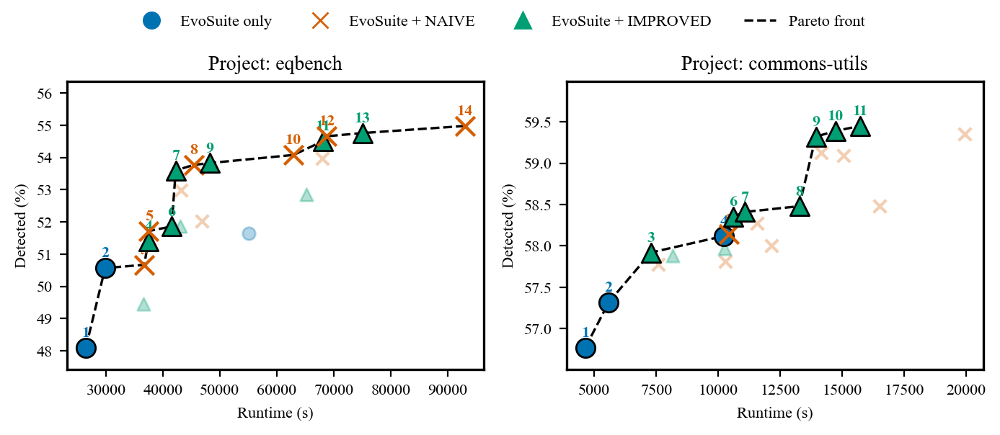
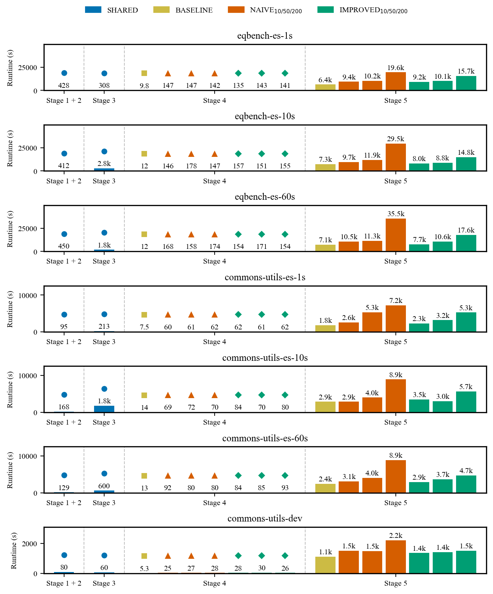
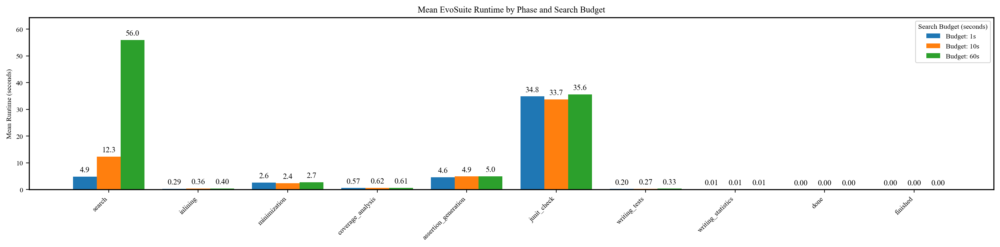

# RQ4 - Efficiency versus EvoSuite

_Source database: `postgres_dev`._

## Efficiency versus EvoSuite

**Pareto points for eqbench.**

| Pt. | EvoSuite | Teralizer | Det. % | Runtime (s) |
| --- | --- | --- | --- | --- |
| 1 | 1s | — | 48.1 | 26,479 |
| 2 | 10s | — | 50.6 | 29,861 |
| 3 | 1s | Naive (10 tries) | 50.7 | 36,728 |
| 4 | 1s | Improved (50 tries) | 51.4 | 37,457 |
| 5 | 1s | Naive (50 tries) | 51.7 | 37,532 |
| 6 | 10s | Improved (10 tries) | 51.9 | 41,525 |
| 7 | 10s | Improved (50 tries) | 53.6 | 42,256 |
| 8 | 10s | Naive (50 tries) | 53.8 | 45,398 |
| 9 | 10s | Improved (200 tries) | 53.8 | 48,269 |
| 10 | 10s | Naive (200 tries) | 54.1 | 62,938 |
| 11 | 60s | Improved (50 tries) | 54.5 | 68,093 |
| 12 | 60s | Naive (50 tries) | 54.7 | 68,782 |
| 13 | 60s | Improved (200 tries) | 54.8 | 75,081 |
| 14 | 60s | Naive (200 tries) | 55.0 | 93,017 |

source: [`compute_pareto_efficiency_analysis`](https://github.com/glockyco/Teralizer/blob/54d4a4e231f92dc5e8bc3238623cc75b7415e8ad/analysis/src/teralizer/rq3_runtime_requirements.py#L162)

**Pareto points for commons-utils.**

| Pt. | EvoSuite | Teralizer | Det. % | Runtime (s) |
| --- | --- | --- | --- | --- |
| 1 | 1s | — | 56.8 | 4,649 |
| 2 | 10s | — | 57.3 | 5,597 |
| 3 | 1s | Improved (10 tries) | 57.9 | 7,294 |
| 4 | 60s | — | 58.1 | 10,240 |
| 5 | 10s | Naive (10 tries) | 58.1 | 10,445 |
| 6 | 10s | Improved (50 tries) | 58.4 | 10,603 |
| 7 | 10s | Improved (10 tries) | 58.4 | 11,082 |
| 8 | 10s | Improved (200 tries) | 58.5 | 13,270 |
| 9 | 60s | Improved (10 tries) | 59.3 | 13,939 |
| 10 | 60s | Improved (50 tries) | 59.4 | 14,728 |
| 11 | 60s | Improved (200 tries) | 59.5 | 15,736 |

source: [`compute_pareto_efficiency_analysis`](https://github.com/glockyco/Teralizer/blob/54d4a4e231f92dc5e8bc3238623cc75b7415e8ad/analysis/src/teralizer/rq3_runtime_requirements.py#L162)

**Pareto fronts for EvoSuite and Teralizer variants across projects.**

source: [`compute_pareto_efficiency_analysis`](https://github.com/glockyco/Teralizer/blob/54d4a4e231f92dc5e8bc3238623cc75b7415e8ad/analysis/src/teralizer/rq3_runtime_requirements.py#L162)

**Teralizer runtime by pipeline stage and variant.**

source: [`compute_stage_runtime_breakdown`](https://github.com/glockyco/Teralizer/blob/54d4a4e231f92dc5e8bc3238623cc75b7415e8ad/analysis/src/teralizer/rq3_runtime_requirements.py#L108)

**Teralizer runtime by pipeline stage for each project and generalization strategy.**

| Project | Strategy | Stage 1 + 2 | Stage 3 | Stage 4 | Stage 5 | Stage 1 + 2 % | Stage 3 % | Stage 4 % | Stage 5 % | Total (s) |
| --- | --- | --- | --- | --- | --- | --- | --- | --- | --- | --- |
| commons-utils-dev | Baseline | 80.0 | 59.8 | 5.3 | 1110.4 | 6.4% | 4.8% | 0.4% | 88.4% | 1255.4 |
| commons-utils-dev | Naive (10 tries) | 80.0 | 59.8 | 25.3 | 1496.4 | 4.8% | 3.6% | 1.5% | 90.1% | 1661.4 |
| commons-utils-dev | Naive (50 tries) | 80.0 | 59.8 | 27.5 | 1490.3 | 4.8% | 3.6% | 1.7% | 89.9% | 1657.5 |
| commons-utils-dev | Naive (200 tries) | 80.0 | 59.8 | 28.1 | 2200.8 | 3.4% | 2.5% | 1.2% | 92.9% | 2368.6 |
| commons-utils-dev | Improved (10 tries) | 80.0 | 59.8 | 28.0 | 1353.9 | 5.3% | 3.9% | 1.8% | 89.0% | 1521.6 |
| commons-utils-dev | Improved (50 tries) | 80.0 | 59.8 | 30.2 | 1420.0 | 5.0% | 3.8% | 1.9% | 89.3% | 1589.9 |
| commons-utils-dev | Improved (200 tries) | 80.0 | 59.8 | 25.7 | 1505.7 | 4.8% | 3.6% | 1.5% | 90.1% | 1671.1 |
| commons-utils-es-10s | Baseline | 167.8 | 1757.2 | 14.0 | 2885.9 | 3.5% | 36.4% | 0.3% | 59.8% | 4824.9 |
| commons-utils-es-10s | Naive (10 tries) | 167.8 | 1757.2 | 68.7 | 2886.9 | 3.4% | 36.0% | 1.4% | 59.2% | 4880.6 |
| commons-utils-es-10s | Naive (50 tries) | 167.8 | 1757.2 | 72.1 | 4011.9 | 2.8% | 29.2% | 1.2% | 66.8% | 6009.0 |
| commons-utils-es-10s | Naive (200 tries) | 167.8 | 1757.2 | 69.8 | 8940.1 | 1.5% | 16.1% | 0.6% | 81.8% | 10934.9 |
| commons-utils-es-10s | Improved (10 tries) | 167.8 | 1757.2 | 84.4 | 3508.2 | 3.0% | 31.8% | 1.5% | 63.6% | 5517.6 |
| commons-utils-es-10s | Improved (50 tries) | 167.8 | 1757.2 | 69.8 | 3044.2 | 3.3% | 34.9% | 1.4% | 60.4% | 5039.0 |
| commons-utils-es-10s | Improved (200 tries) | 167.8 | 1757.2 | 80.0 | 5701.8 | 2.2% | 22.8% | 1.0% | 74.0% | 7706.8 |
| commons-utils-es-1s | Baseline | 95.3 | 213.2 | 7.5 | 1793.5 | 4.5% | 10.1% | 0.4% | 85.0% | 2109.5 |
| commons-utils-es-1s | Naive (10 tries) | 95.3 | 213.2 | 60.3 | 2594.5 | 3.2% | 7.2% | 2.0% | 87.6% | 2963.3 |
| commons-utils-es-1s | Naive (50 tries) | 95.3 | 213.2 | 61.0 | 5303.7 | 1.7% | 3.8% | 1.1% | 93.5% | 5673.2 |
| commons-utils-es-1s | Naive (200 tries) | 95.3 | 213.2 | 61.6 | 7162.6 | 1.3% | 2.8% | 0.8% | 95.1% | 7532.7 |
| commons-utils-es-1s | Improved (10 tries) | 95.3 | 213.2 | 62.2 | 2291.7 | 3.6% | 8.0% | 2.3% | 86.1% | 2662.4 |
| commons-utils-es-1s | Improved (50 tries) | 95.3 | 213.2 | 61.1 | 3170.0 | 2.7% | 6.0% | 1.7% | 89.6% | 3539.6 |
| commons-utils-es-1s | Improved (200 tries) | 95.3 | 213.2 | 62.1 | 5253.9 | 1.7% | 3.8% | 1.1% | 93.4% | 5624.5 |
| commons-utils-es-60s | Baseline | 129.0 | 600.0 | 12.9 | 2409.0 | 4.1% | 19.0% | 0.4% | 76.5% | 3151.0 |
| commons-utils-es-60s | Naive (10 tries) | 129.0 | 600.0 | 91.7 | 3127.5 | 3.3% | 15.2% | 2.3% | 79.2% | 3948.4 |
| commons-utils-es-60s | Naive (50 tries) | 129.0 | 600.0 | 80.3 | 4027.9 | 2.7% | 12.4% | 1.7% | 83.3% | 4837.3 |
| commons-utils-es-60s | Naive (200 tries) | 129.0 | 600.0 | 79.7 | 8903.6 | 1.3% | 6.2% | 0.8% | 91.7% | 9712.3 |
| commons-utils-es-60s | Improved (10 tries) | 129.0 | 600.0 | 84.0 | 2912.2 | 3.5% | 16.1% | 2.3% | 78.2% | 3725.2 |
| commons-utils-es-60s | Improved (50 tries) | 129.0 | 600.0 | 85.4 | 3699.6 | 2.9% | 13.3% | 1.9% | 82.0% | 4514.1 |
| commons-utils-es-60s | Improved (200 tries) | 129.0 | 600.0 | 93.2 | 4699.9 | 2.3% | 10.9% | 1.7% | 85.1% | 5522.2 |
| eqbench-es-10s | Baseline | 412.5 | 2776.1 | 12.3 | 7292.9 | 3.9% | 26.5% | 0.1% | 69.5% | 10493.7 |
| eqbench-es-10s | Naive (10 tries) | 412.5 | 2776.1 | 145.6 | 9676.3 | 3.2% | 21.3% | 1.1% | 74.4% | 13010.5 |
| eqbench-es-10s | Naive (50 tries) | 412.5 | 2776.1 | 177.9 | 11896.4 | 2.7% | 18.2% | 1.2% | 77.9% | 15262.9 |
| eqbench-es-10s | Naive (200 tries) | 412.5 | 2776.1 | 147.2 | 29467.1 | 1.3% | 8.5% | 0.4% | 89.8% | 32802.9 |
| eqbench-es-10s | Improved (10 tries) | 412.5 | 2776.1 | 156.5 | 8045.1 | 3.6% | 24.4% | 1.4% | 70.6% | 11390.3 |
| eqbench-es-10s | Improved (50 tries) | 412.5 | 2776.1 | 151.1 | 8782.2 | 3.4% | 22.9% | 1.2% | 72.4% | 12121.9 |
| eqbench-es-10s | Improved (200 tries) | 412.5 | 2776.1 | 154.6 | 14790.5 | 2.3% | 15.3% | 0.9% | 81.6% | 18133.8 |
| eqbench-es-1s | Baseline | 428.5 | 307.7 | 9.8 | 6422.2 | 6.0% | 4.3% | 0.1% | 89.6% | 7168.3 |
| eqbench-es-1s | Naive (10 tries) | 428.5 | 307.7 | 146.7 | 9398.6 | 4.2% | 3.0% | 1.4% | 91.4% | 10281.6 |
| eqbench-es-1s | Naive (50 tries) | 428.5 | 307.7 | 146.8 | 10202.3 | 3.9% | 2.8% | 1.3% | 92.0% | 11085.4 |
| eqbench-es-1s | Naive (200 tries) | 428.5 | 307.7 | 142.5 | 19577.8 | 2.1% | 1.5% | 0.7% | 95.7% | 20456.5 |
| eqbench-es-1s | Improved (10 tries) | 428.5 | 307.7 | 134.9 | 9234.7 | 4.2% | 3.0% | 1.3% | 91.4% | 10105.9 |
| eqbench-es-1s | Improved (50 tries) | 428.5 | 307.7 | 143.0 | 10131.5 | 3.9% | 2.8% | 1.3% | 92.0% | 11010.8 |
| eqbench-es-1s | Improved (200 tries) | 428.5 | 307.7 | 140.6 | 15696.3 | 2.6% | 1.9% | 0.8% | 94.7% | 16573.2 |
| eqbench-es-60s | Baseline | 450.5 | 1818.6 | 12.2 | 7143.8 | 4.8% | 19.3% | 0.1% | 75.8% | 9425.1 |
| eqbench-es-60s | Naive (10 tries) | 450.5 | 1818.6 | 168.4 | 10471.0 | 3.5% | 14.1% | 1.3% | 81.1% | 12908.5 |
| eqbench-es-60s | Naive (50 tries) | 450.5 | 1818.6 | 158.3 | 11317.2 | 3.3% | 13.2% | 1.2% | 82.3% | 13744.6 |
| eqbench-es-60s | Naive (200 tries) | 450.5 | 1818.6 | 173.9 | 35538.2 | 1.2% | 4.8% | 0.5% | 93.6% | 37981.2 |
| eqbench-es-60s | Improved (10 tries) | 450.5 | 1818.6 | 154.3 | 7711.8 | 4.4% | 17.9% | 1.5% | 76.1% | 10135.2 |
| eqbench-es-60s | Improved (50 tries) | 450.5 | 1818.6 | 170.9 | 10615.9 | 3.5% | 13.9% | 1.3% | 81.3% | 13055.9 |
| eqbench-es-60s | Improved (200 tries) | 450.5 | 1818.6 | 153.9 | 17621.0 | 2.2% | 9.1% | 0.8% | 87.9% | 20044.0 |

_Stages 1 to 3 run once per project and count toward every strategy._

source: [`compute_stage_runtime_breakdown`](https://github.com/glockyco/Teralizer/blob/54d4a4e231f92dc5e8bc3238623cc75b7415e8ad/analysis/src/teralizer/rq3_runtime_requirements.py#L108)

**Total Teralizer runtime per project across all generalization strategies.**

| Project | Runtime (s) | Runtime (h) |
| --- | --- | --- |
| commons-utils-dev | 12203.0 | 3.39 |
| commons-utils-es-10s | 35208.3 | 9.78 |
| commons-utils-es-1s | 29635.1 | 8.23 |
| commons-utils-es-60s | 32672.1 | 9.08 |
| eqbench-es-10s | 101792.4 | 28.28 |
| eqbench-es-1s | 89187.7 | 24.77 |
| eqbench-es-60s | 111202.0 | 30.89 |

source: [`_fetch_project_runtimes`](https://github.com/glockyco/Teralizer/blob/a421ce6ab66c4d6666716bc8acb3c5a9ab0d7764/analysis/src/teralizer/eval/reports/rq4_efficiency_evosuite.py#L254)

**Mean EvoSuite runtime per phase, by project and search budget.**

| Project | Budget (s) | Total | Search | Inlining | Minimization | Coverage Analysis | Assertion Generation | Junit Check | Writing Tests |
| --- | --- | --- | --- | --- | --- | --- | --- | --- | --- |
| commons-utils-es-default-10s | 10.00 | 53.31 | 10.15 | 0.07 | 0.80 | 0.07 | 3.86 | 38.30 | 0.04 |
| commons-utils-es-default-1s | 1.00 | 44.27 | 2.10 | 0.04 | 0.81 | 0.06 | 3.35 | 37.86 | 0.04 |
| commons-utils-es-default-60s | 60.00 | 97.52 | 54.48 | 0.06 | 0.51 | 0.06 | 4.39 | 37.97 | 0.05 |
| eqbench-es-default-10s | 10.00 | 54.89 | 12.75 | 0.42 | 2.71 | 0.72 | 5.11 | 32.85 | 0.31 |
| eqbench-es-default-1s | 1.00 | 48.67 | 5.39 | 0.33 | 2.95 | 0.67 | 4.82 | 34.27 | 0.23 |
| eqbench-es-default-60s | 60.00 | 101.24 | 56.30 | 0.47 | 3.13 | 0.72 | 5.07 | 35.16 | 0.38 |

_Each row is the mean over the runs of one project at one search budget._

source: [`compute_evosuite_phase_statistics`](https://github.com/glockyco/Teralizer/blob/54d4a4e231f92dc5e8bc3238623cc75b7415e8ad/analysis/src/teralizer/rq3_runtime_requirements.py#L310)

**Mean EvoSuite runtime by phase and search budget.**

source: [`compute_evosuite_phase_statistics`](https://github.com/glockyco/Teralizer/blob/54d4a4e231f92dc5e8bc3238623cc75b7415e8ad/analysis/src/teralizer/rq3_runtime_requirements.py#L310)
